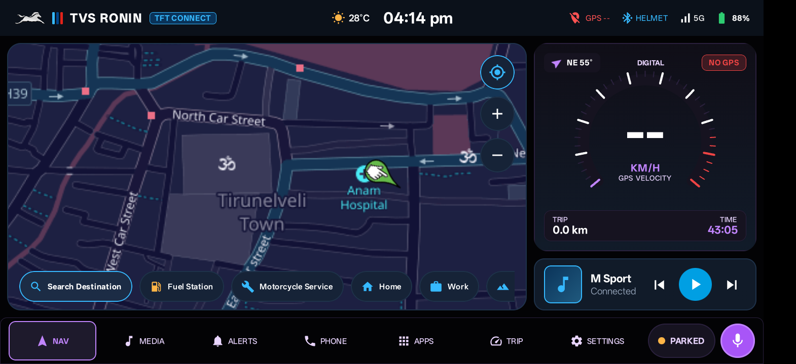
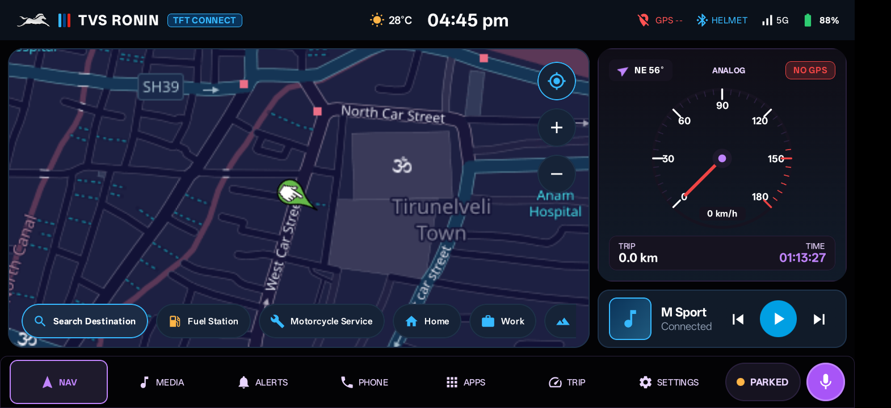
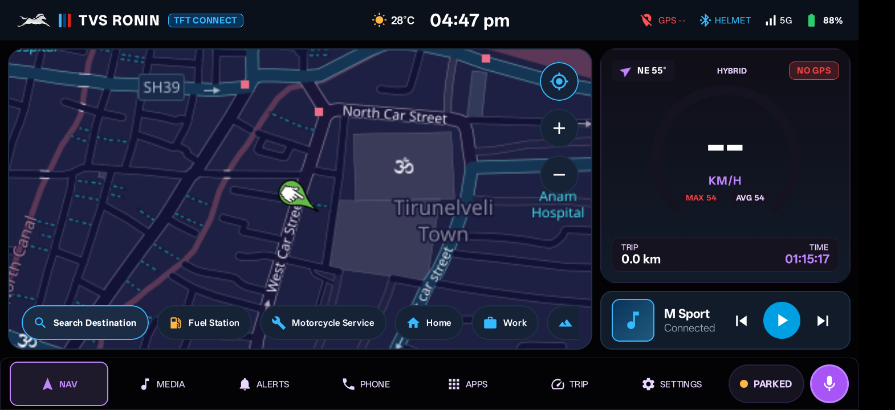
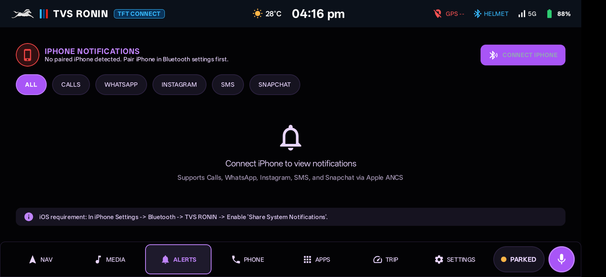
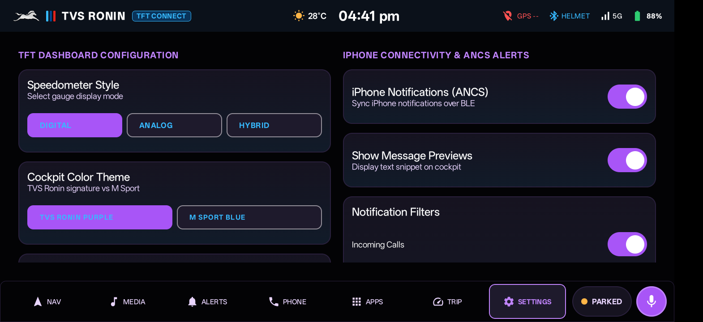

# TVS RONIN 225 – Smart Motorcycle Infotainment System
### Premium Motorcycle Cockpit & TFT Dashboard for Realme C83



A fully functional, automotive-grade Android motorcycle infotainment operating system engineered specifically for the **TVS Ronin 225** mounted on a **Realme C83** smartphone. Built natively using **Kotlin**, **Jetpack Compose**, **Material 3**, and **MVVM architecture**.

---

## 🏍️ Key Highlights & Features

### 1. 100% Embedded In-App Navigation
- **Zero App Switching**: Navigation runs entirely inside the application. No redirects to external browser windows, no popups, and no external app intents.
- **Interactive High-Contrast Vector Map**: Responsive embedded map canvas optimized for landscape handlebar viewing with full gesture control (pan, pinch-to-zoom, re-center).
- **Route Tracking & Turn HUD**: Real-time GPS location tracking, custom directional vehicle indicator, upcoming turn instruction, remaining distance, and ETA.
- **Motorcycle Waypoint Presets**: One-tap navigation to **Fuel Station**, **Motorcycle Service**, **Home**, **Work**, and scenic riding routes.

### 2. Multi-Mode GPS Speedometer Cluster
Switchable in real-time from Settings to match your riding preference:
- **Digital Speedometer** *(Default)*: Modern digital velocity gauge with graduated arc markings, high-contrast km/h display, and compass orientation.
- **Classic Analog Speedometer**: 270° circular gauge dial (0–180 km/h) with sweeping physical illuminated red needle, purple center hub, and digital odometer readout.
- **Hybrid Sport Speedometer**: Tachometer arc with digital speed and dedicated **MAX** & **AVG** telemetry badges.
- **Adaptive Velocity Filter**: $\alpha = 0.65$ during acceleration and braking for instant responsiveness; $\alpha = 0.25$ during cruising to eliminate GPS jitter.
- **Signal Quality Guard**: Rejects inaccurate fixes (>35 m) and gracefully handles signal loss with smooth speed decay.

| Digital Mode | Classic Analog Mode | Hybrid Sport Mode |
| :---: | :---: | :---: |
|  |  |  |

### 3. iPhone-to-Android Connectivity (Apple ANCS & AMS over BLE)
Engineered for riders using an iPhone as their primary pocket phone while using the Android device as the handlebar cockpit:
- **Apple Notification Center Service (ANCS)**:
  - Secure BLE GATT Client connection (`7905F431-B5CE-4E99-A40F-4B1E122D00D0`).
  - Real-time alerts for **Incoming Calls**, **WhatsApp**, **Instagram**, **SMS**, and **Snapchat**.
  - Displays sender name, message preview snippet, app badge, and timestamp.
  - Dedicated **ALERTS** tab in the bottom bar with unread notification counter.
- **Apple Media Service (AMS)**:
  - BLE GATT Client (`89D3502B-0F36-433A-8EF4-C502540A8331`).
  - Remote music playback control (**Play**, **Pause**, **Next Track**, **Previous Track**, **Volume**).
  - Displays live track title, artist name, and album information from Spotify, Apple Music, and other iOS media players while the phone stays securely tucked away.

| iPhone Notification Center | Cockpit Configuration & Settings |
| :---: | :---: |
|  |  |

### 4. TVS Ronin Signature Design System
- **Pure AMOLED Black**: `#030305` background for battery efficiency and maximum glare resistance.
- **Ronin Neon Purple & Racing Red**: Signature `#A855F7` accents with `#EF4444` alerts.
- **Silver Leaping Horse Emblem**: TVS official brand identity integrated into the top cockpit status bar.
- **Theme Selection**: Switch between **TVS Ronin Neon Purple** and **M Sport Blue** in Settings.

---

## 📱 Hardware & Target Configuration

- **Device**: Realme C83 (RMX3834 / Android 16 API 36)
- **Orientation**: Fixed Landscape with full sensor orientation support
- **Stack**: Kotlin, Jetpack Compose, Material 3, Coroutines, StateFlow, DataStore Preferences
- **Architecture**: MVVM with reactive repository layers

---

## 🚀 Setup & iPhone Pairing

### 1. Build & Install
```bash
# Clone the repository
git clone https://github.com/<your-username>/Bike_Infosystem.git
cd Bike_Infosystem

# Build release APK
./gradlew assembleRelease

# Install on connected device via ADB
adb install -r app/build/outputs/apk/release/app-release.apk
```

### 2. iPhone ANCS Pairing
1. On Realme C83, turn on Bluetooth and launch the TVS Ronin app.
2. On your iPhone, go to **Settings ➜ Bluetooth** and tap **TVS RONIN** to pair.
3. Tap the **ⓘ (Info)** icon next to **TVS RONIN** in iPhone Bluetooth settings.
4. Enable **"Share System Notifications"** (or "Show Notifications").
5. Notifications will now stream directly to the cockpit's **ALERTS** tab and music can be controlled from the media bar.

---

## 📄 License
This project is an independent custom motorcycle infotainment system designed for the TVS Ronin 225 community.
